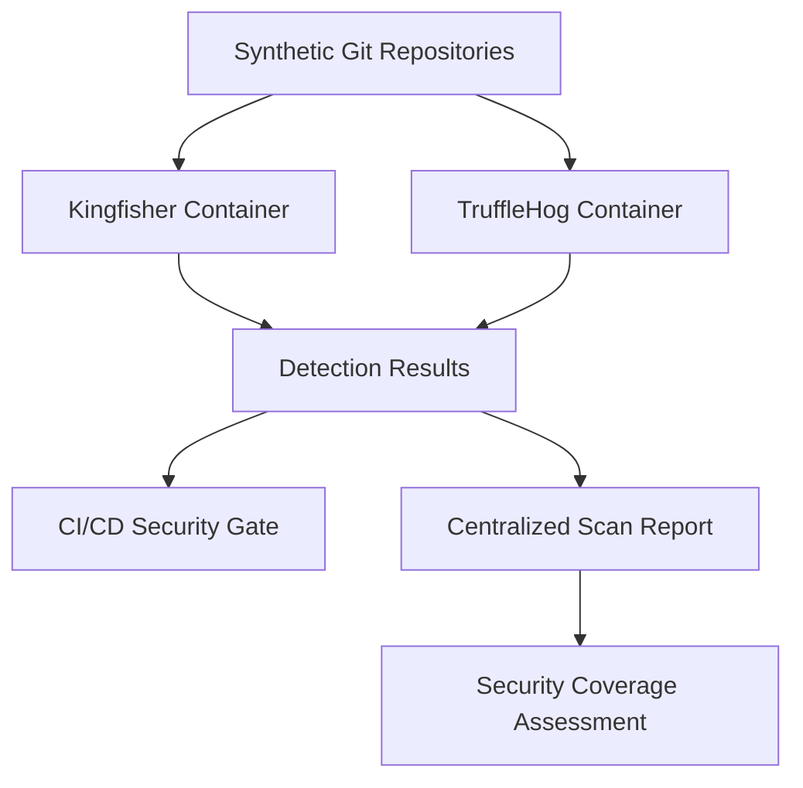
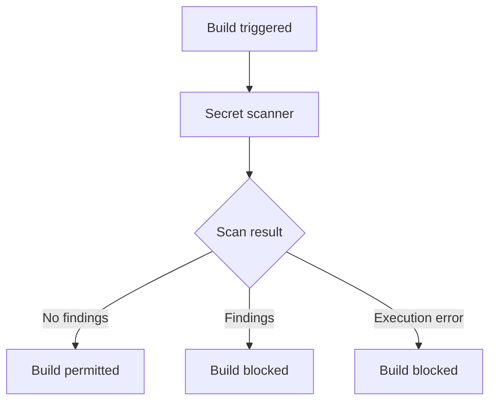

# Secret Scanning Benchmark

### Kingfisher vs. TruffleHog

A practical, independent evaluation of open-source
secret scanning tools for DevSecOps environments.


## Executive Summary

This project evaluates Kingfisher and TruffleHog
through practical testing in an isolated Docker
environment using synthetic credentials.

The evaluation focuses on secret detection,
Git history scanning, automated build security,
centralized repository scanning, reporting,
error handling and operational overhead.

All repositories and credentials were created
exclusively for this evaluation.

No production systems, corporate repositories
or active credentials were used.

## Tools Evaluated

| Tool | Version | License |
|---|---|---|
| Kingfisher | 2.20.0 | Apache 2.0 |
| TruffleHog | 3.100.1 | AGPL 3.0 |

## Lab Architecture



## Test Environment

- Windows with Git Bash
- Docker Desktop
- Four isolated Git repositories
- Read-only repository mounts
- Disabled container network access
- Disabled external credential verification
- Locally generated synthetic credentials

## Repository Scenarios

| Repository | Purpose |
|---|---|
| repo-clean | Secure source code |
| repo-exposed | Hardcoded credentials |
| repo-history | Removed historical credentials |
| repo-extended | Extended credential dataset |

## Benchmark Results

| Evaluation criterion | Kingfisher | TruffleHog |
|---|---|---|
| Initial detection | 2/5 | 2/5 |
| Extended detection | 6/10 | 5/10 |
| Git history detection | Pass | Pass |
| Clean repository findings | 0 | 0 |
| Build blocking | Pass | Pass |
| Centralized scanning | Pass | Pass |
| Invalid target handling | Pass | Pass |
| Incomplete coverage handling | Pass | Pass |
| Native redaction demonstrated | Yes | No |
| Average build scan duration | 11 s | 8.75 s |
| Central scan run 1 | 44 s | 37 s |
| Central scan run 2 | 44 s | 35 s |

## Extended Detection Results

| Credential type | Kingfisher | TruffleHog |
|---|---|---|
| AWS credentials | Not detected | Detected |
| GitHub PAT | Detected | Detected |
| Stripe API key | Not detected | Not detected |
| Slack bot token | Not detected | Not detected |
| GitLab PAT | Detected | Detected |
| SendGrid API key | Detected | Not detected |
| Generic password | Not detected | Not detected |
| PostgreSQL URI | Detected | Not detected |
| MongoDB URI | Detected | Detected |
| RSA private key | Detected | Detected |

The combined tools detected seven of the ten
extended synthetic credential categories.

These results describe only the tested dataset
and must not be interpreted as general detection
accuracy.

## CI/CD Security Gate



Both tools successfully blocked simulated builds
when potential secrets were detected.

The tested implementation scanned full Git
history. Production build gates should normally
focus on newly introduced changes after an
initial historical assessment.

## Centralized Repository Scanning

Both scanners successfully processed all four
local repositories.

A separate coverage test introduced an
unavailable repository.

| Metric | Normal scenario | Incomplete scenario |
|---|---|---|
| Discovered repositories | 4 | 5 |
| Successful scans | 4 | 4 |
| Failed scans | 0 | 1 |
| Reported coverage | 100% | 80% |

The coverage percentage represents repository
processing status, not complete detection of
all secrets or all repository content.

## Security Control Coverage

A simulated inventory identified one repository
without build-time secret scanning.

| Control | Coverage |
|---|---|
| Simulated build scanning | 75% |
| Centralized repository scanning | 100% |

Centralized scanning identified findings
independently of the simulated build control.

## Preliminary Recommendation

Kingfisher is recommended as the initial pilot
candidate based on:

- Broader detection in the extended synthetic dataset.
- Demonstrated native secret redaction.
- Detailed finding metadata.
- Permissive Apache 2.0 licensing.

TruffleHog remains a strong alternative,
particularly due to:

- Successful AWS credential detection.
- Detailed Git commit metadata.
- Credential rotation guidance.
- Lower observed end-to-end Docker execution time.

A production decision requires additional
validation using representative, authorized
repositories and organization-specific requirements.

## Limitations

- Small synthetic dataset.
- Synthetic tokens may differ from actual provider formats.
- No active credential validation.
- No blast radius or revocation testing.
- Local repositories rather than a real GitHub organization.
- Simulated CI/CD builds.
- Simulated security control inventory.
- Scheduled wrapper tested manually, not by a timed trigger.
- Limited performance measurements.
- Exit-code-based coverage does not prove complete scan coverage.

## Documentation

- [Architecture](docs/architecture.md)
- [Test Methodology](docs/methodology.md)
- [Implementation Guide](docs/implementation-guide.md)
- [Security Considerations](docs/security-considerations.md)
- [Test Plan](test-cases/test-plan.md)
- [Test Results](test-cases/test-results.md)
- [Comparison Report](reports/comparison/comparison.md)
- [Benchmark Dataset](reports/comparison/benchmark-results.csv)

## References

- [Kingfisher](https://github.com/mongodb/kingfisher)
- [TruffleHog](https://github.com/trufflesecurity/trufflehog)

## Disclaimer

This project is an independent educational
security evaluation and is not affiliated with
either tool vendor.

All testing was performed in an isolated
environment using synthetic credentials.

## Quick Start

### Prerequisites

- Docker Desktop or Docker Engine
- Docker Compose
- Git
- Bash
- OpenSSL
- SSH key generation utilities

### Initialize the laboratory

```bash
docker compose pull
bash lab/setup-lab.sh
```

The setup script generates four synthetic Git
repositories locally.

Existing test repositories will not be overwritten.

### Test build security gates

```bash
bash scripts/build-check.sh kingfisher repo-clean
bash scripts/build-check.sh kingfisher repo-exposed

bash scripts/build-check.sh trufflehog repo-clean
bash scripts/build-check.sh trufflehog repo-exposed
```

### Run centralized scanning

```bash
bash scripts/central-scan.sh kingfisher
bash scripts/central-scan.sh trufflehog
```

### Check simulated security control coverage

```bash
bash scripts/coverage-check.sh
```

### Execute both scanners sequentially

```bash
bash scripts/scheduled-scan.sh
```

### Exit codes

The laboratory automation scripts normalize
scanner-specific exit codes.

| Exit code | Meaning |
|---|---|
| 0 | No reported findings |
| 1 | Findings or policy violation |
| 2 | Execution or coverage error |

Non-zero exit codes are expected when testing
repositories containing synthetic secrets.

### Reporting

Sanitized comparison reports are available in
reports/comparison/.

Raw scanner outputs and generated credentials
must not be published.

### Dependencies

See [Dependencies and Licensing](docs/dependencies.md).

