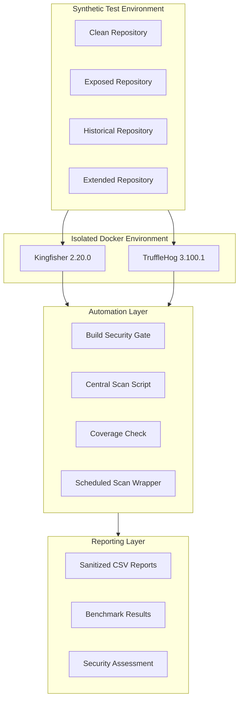
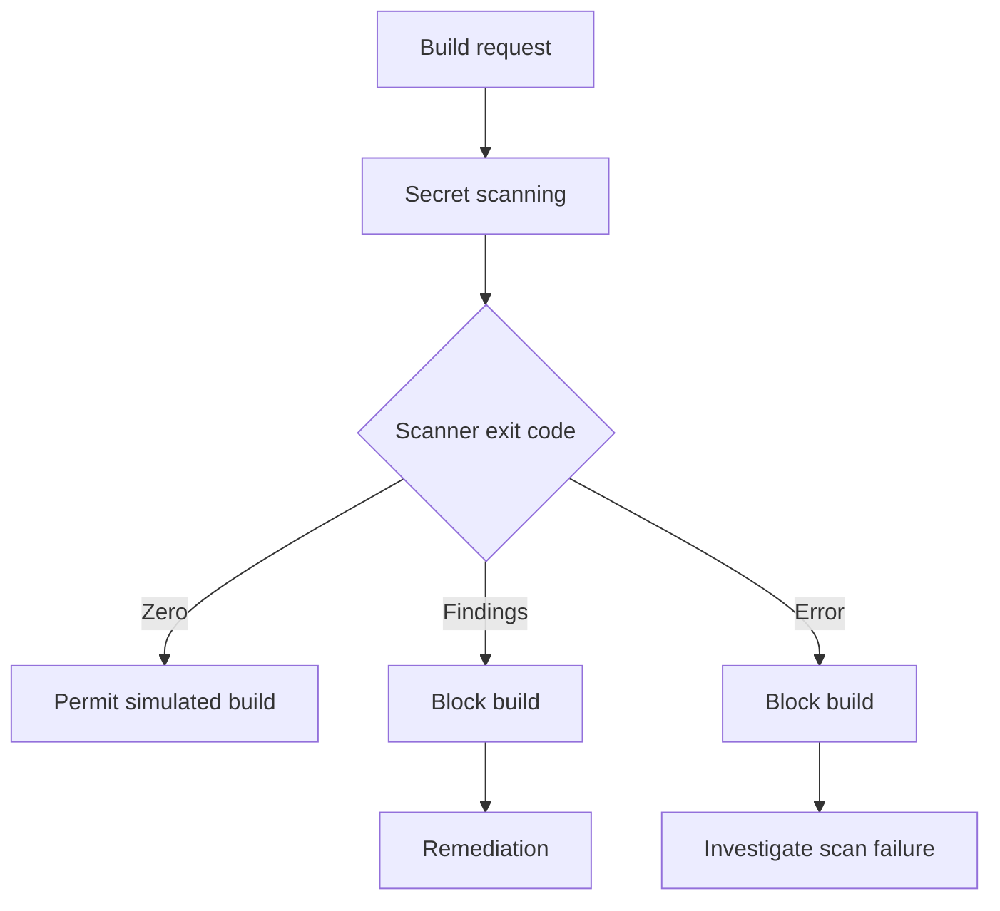
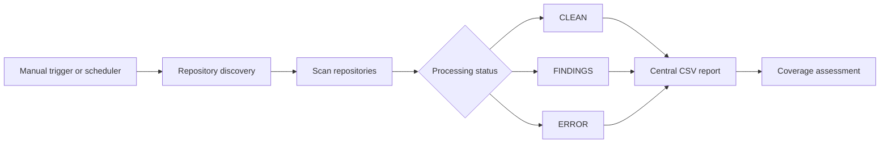

# System Architecture

## Overview

The Secret Scanning Benchmark uses an isolated
container-based architecture to evaluate two
open-source secret scanning tools under comparable
conditions.

## High-Level Architecture

## Security Boundaries

- Repository mounts are read-only.
- Scanner containers have no network access.
- External credential validation is disabled.
- Generated credentials are synthetic.
- Raw scanner reports remain local.
- Public reports contain sanitized results only.

## CI/CD Security Gate

The security gate normalizes scanner-specific
exit codes into a common pipeline result.

## Centralized Scanning

## Coverage Model

The central scanning script reports the number
of discovered and successfully processed local
repository directories.

A separate simulated inventory represents
build-time security control coverage.

These are independent measurements and do not
establish complete content-level scan coverage.

## Production Considerations

A production implementation should include:

- Authoritative repository inventory.
- Least-privilege scanner identities.
- Centrally maintained pipeline templates.
- Required security status checks.
- Restricted reporting and alerting.
- Secret rotation and incident response.
- Scan completeness verification.
- Automated scheduling and monitoring.
